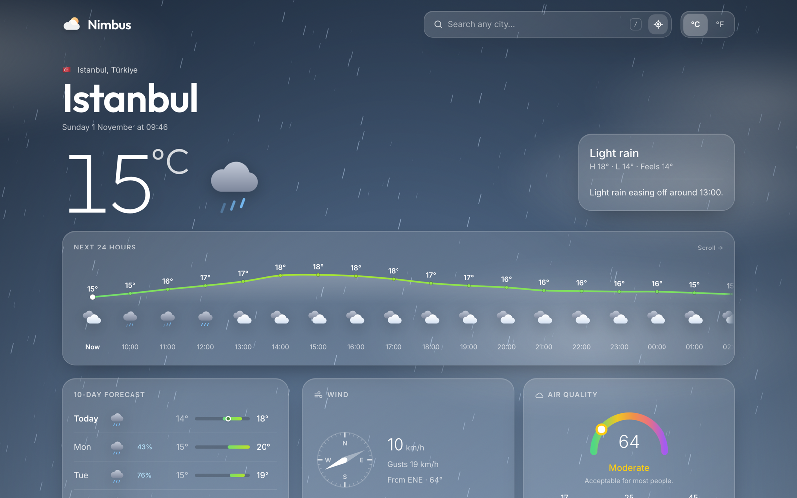
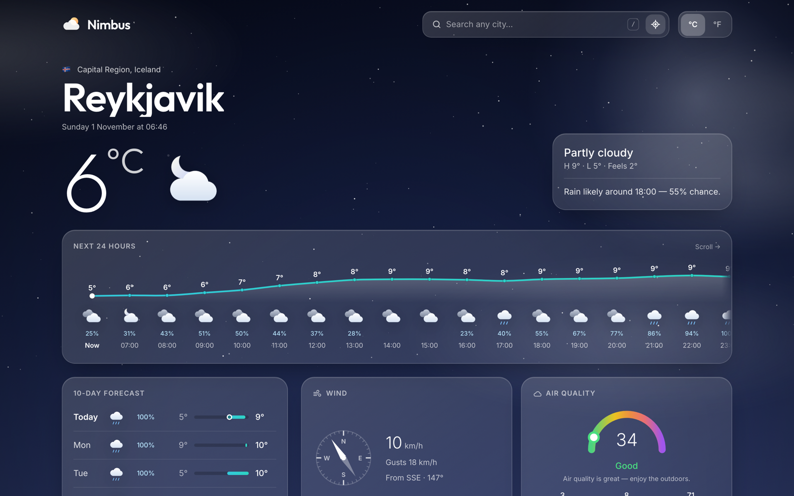
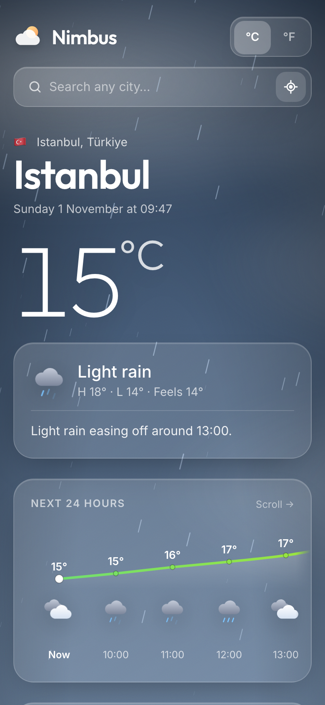

<div align="center">

# ☁️ Nimbus

**Weather, beautifully.** A cinematic real-time weather app with a living, animated sky.

[**→ Live demo**](https://efkanakalin.github.io/nimbus-weather/)


</div>



## Highlights

- **A sky that matches the weather.** The background is rendered live from the current conditions:
  falling rain, drifting snow, twinkling stars at night, lightning during storms, rolling fog and
  slow-moving clouds. Colours shift smoothly between day and night.
- **Hand-drawn animated icons.** Every condition has its own SVG icon: rays turn, clouds drift,
  rain falls.
- **Next 24 hours** as a smooth, temperature-coloured curve, with rain chance per hour.
- **10-day forecast** with range bars on a shared scale and a marker for the current temperature.
- **Details at a glance:** wind compass with gusts, an air-quality gauge (US AQI, PM2.5, PM10, O₃),
  a sunrise and sunset arc that follows the sun, UV index, feels-like, humidity and dew point,
  visibility and pressure.
- **Plain-language outlook**, e.g. *"Rain likely around 18:00 — 55% chance."*
- **Instant city search** with autocomplete, country flags and full keyboard support
  (`/` to focus, ↑ ↓ to move, Enter to pick), plus one-tap **"use my location"**.
- **°C / °F switch**, recent cities and your last city remembered between visits.
- Shows the **local time of the city** you are viewing and refreshes itself every 10 minutes.
- Responsive from phone to ultra-wide, accessible labels, and respects *reduce motion*.

| Clear night in Reykjavík | On mobile |
|---|---|
|  |  |

## Run it locally

```bash
git clone https://github.com/efkanakalin/nimbus-weather.git
cd nimbus-weather
npm install
npm run dev
```

No API key and no `.env` are needed. Every data source is free and open:

| Data | Source |
|---|---|
| Forecast, current conditions, UV | [Open-Meteo Forecast API](https://open-meteo.com/) |
| Air quality | [Open-Meteo Air Quality API](https://open-meteo.com/en/docs/air-quality-api) |
| City search | [Open-Meteo Geocoding API](https://open-meteo.com/en/docs/geocoding-api) |
| "Use my location" city name | [BigDataCloud reverse geocoding](https://www.bigdatacloud.com/free-api/free-reverse-geocode-to-city-api) |

## Project structure

```
src/
├── App.jsx               layout, state, persistence
├── components/
│   ├── Sky.jsx           animated background (gradient, clouds, canvas particles)
│   ├── WeatherIcon.jsx   animated SVG weather icons
│   ├── SearchBar.jsx     autocomplete city search + geolocation
│   ├── Hero.jsx          city, local clock, big temperature, outlook
│   ├── Hourly.jsx        24-hour temperature curve
│   ├── Daily.jsx         10-day forecast range bars
│   └── Details.jsx       wind, air quality, sun, UV and more
└── lib/
    ├── weather.js        API calls
    ├── conditions.js     WMO codes, sky palettes, AQI / UV scales
    └── format.js         units, dates and helpers
```

## Deploy

`npm run build` creates a static site in `dist/`. This repository deploys itself to **GitHub Pages**
on every push to `main` (`.github/workflows/deploy.yml`).

---

<sub>This is my first project, rebuilt from the ground up. Made by [Efkan Akalın](https://github.com/efkanakalin).</sub>
